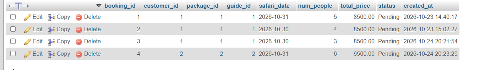
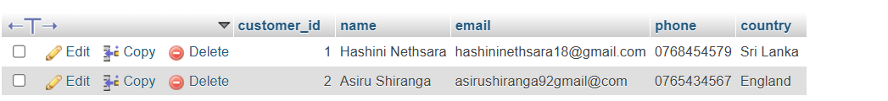
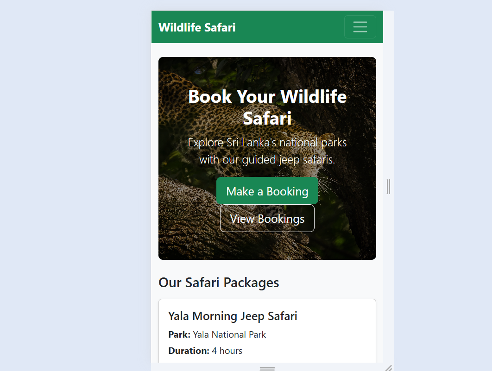

# Online Wildlife Safari Reservation and Management System

EE4307 Web Application Development Mini Project

**Student:** [Singaneththi H N] | **Index number:** [EG/2023/5899]

## Description

A web application for booking wildlife jeep safaris in Sri Lankan national parks (Yala, Udawalawe and Wilpattu). Staff can create, view, edit and delete bookings, and all data is stored in a MySQL database. Safari prices are calculated **per jeep**, not per person. One jeep carries up to 6 people, so larger groups automatically book extra jeeps.

## Features

- **Create:** add a booking with customer details, safari package, guide, date and number of people
- **Read:** booking list with search by customer name, filter by status, sort by date or price, and a details page
- **Update:** edit a booking and change its status (Pending, Confirmed, Cancelled)
- **Delete:** remove a booking after an "Are you sure?" confirmation popup
- **Validation:** client-side (browser) and server-side (Node.js) checks with clear error messages
- **Automatic pricing:** price per jeep x number of jeeps needed
- **Responsive design** for mobile, tablet and desktop
- Custom 404 error page

## Technologies Used

| Part | Technology |
|---|---|
| Server | Node.js, Express |
| Templates | EJS |
| Database | MySQL (XAMPP), `mysql2` package |
| Front end | Bootstrap 5, HTML, CSS, JavaScript |
| Other packages | dotenv, method-override |
| Version control | Git and GitHub |

## Setup Steps

1. Install [Node.js](https://nodejs.org) (LTS version) and [XAMPP](https://www.apachefriends.org).
2. Open the XAMPP Control Panel and start **Apache** and **MySQL**.
3. Clone the repository:
   ```
   git clone https://github.com/hashininethsara18-wq/Online-Wildlife-Safari-Reservation-and-Management-System.git
   cd Online-Wildlife-Safari-Reservation-and-Management-System
   ```
4. Install the packages:
   ```
   npm install
   ```
5. Create the database: open `http://localhost/phpmyadmin`, click the **Import** tab, choose the file `database.sql`, and click **Go**. This creates the database `safari_db` with sample data.
6. Copy `.env.example` and rename the copy to `.env`. The default values work with XAMPP (user `root`, empty password).
7. Start the application:
   ```
   node app.js
   ```
8. Open `http://localhost:3000` in your browser.

If MySQL does not start in XAMPP, another MySQL service may be using port 3306. Stop it in Windows Services and try again.

## Database Design

The database `safari_db` has 5 tables:

| Table | Purpose | Key columns |
|---|---|---|
| `parks` | National parks | `park_id` (PK) |
| `safari_packages` | Safari packages of each park | `package_id` (PK), `park_id` (FK), `price_per_jeep`, `max_capacity` |
| `guides` | Safari guides | `guide_id` (PK) |
| `customers` | Customer details | `customer_id` (PK), `email` (unique) |
| `bookings` | Reservations (main entity) | `booking_id` (PK), `customer_id` (FK), `package_id` (FK), `guide_id` (FK) |

Relationships:

- One park has many safari packages.
- One customer can make many bookings.
- One package can be used in many bookings.
- One guide can be assigned to many bookings.


## Screenshots

### Home page


### Create booking


### Booking list with search, filter and sort


### Booking details


### Edit booking


### Delete confirmation


### Validation messages


### Database records (phpMyAdmin)



### Mobile view



## Project Structure

```
safari-project/
├── app.js                main server file
├── config/
│   └── db.js             database connection
├── routes/
│   └── bookings.js       booking routes (create, read, update, delete)
├── views/
│   ├── index.ejs         home page
│   ├── error.ejs         404 page
│   ├── bookings/         new, list, details and edit pages
│   └── partials/         header, footer and error box
├── public/
│   ├── css/style.css     custom styles
│   ├── js/validation.js  browser validation
│   └── images/hero.jpg   home page photo
├── docs/                 ERD and screenshots
├── database.sql          database schema and sample data
└── .env.example          example settings
```

## Validation Rules

| Field | Rule |
|---|---|
| Name | At least 2 characters |
| Email | Must be a valid email address |
| Phone | 7 to 15 characters (numbers, +, - and spaces) |
| Safari date | Cannot be in the past |
| Number of people | Whole number from 1 to 30 |
| Package | Must be selected and must exist |
| Status | Pending, Confirmed or Cancelled only |

## Notes

- Database credentials are stored in `.env`, which is not uploaded to GitHub. Use `.env.example` as a guide.
- Default XAMPP MySQL login: user `root`, no password.
- Home page photo from [https://www.pexels.com/photo/sri-lankan-leopard-stealthily-prowling-on-tree-branch-33130315/], photographer: [Rajee Kumar], used under the site's free licence.