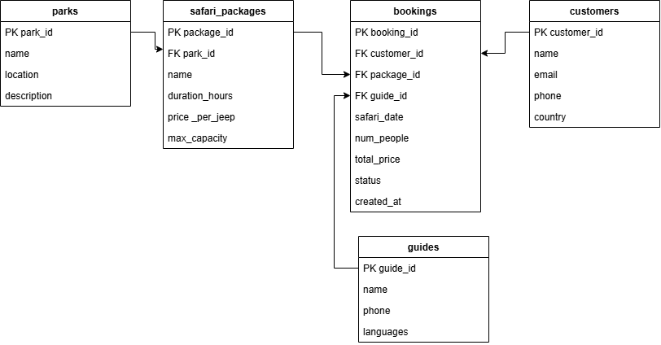
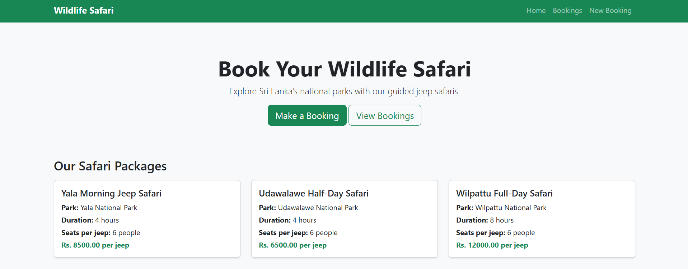
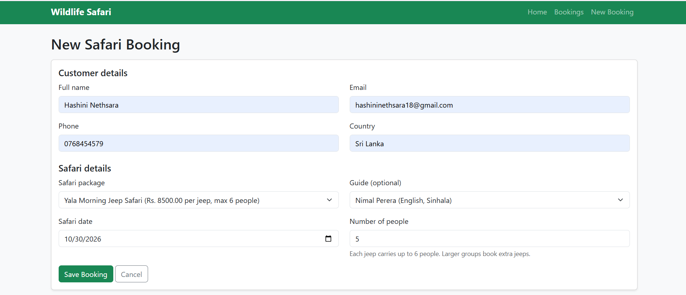
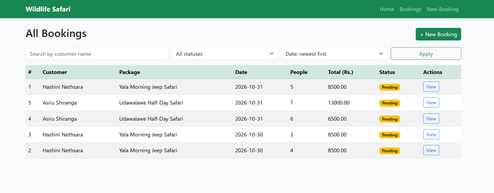
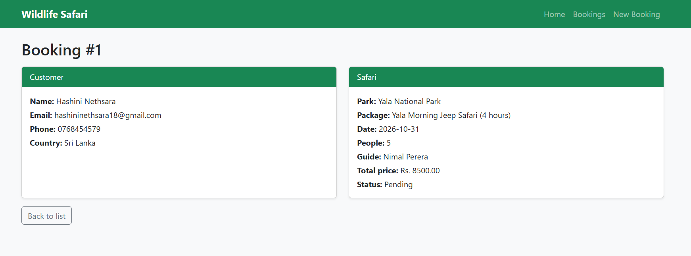
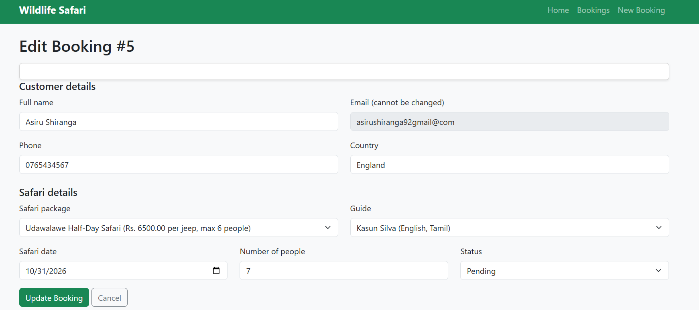
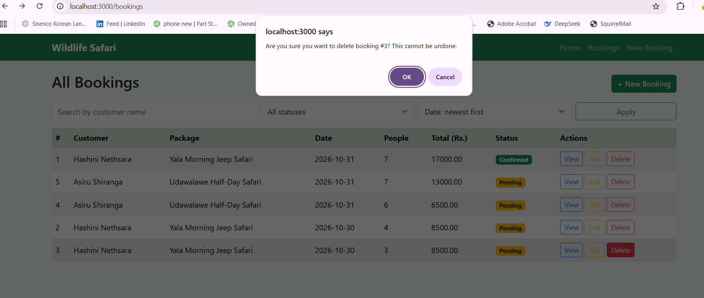
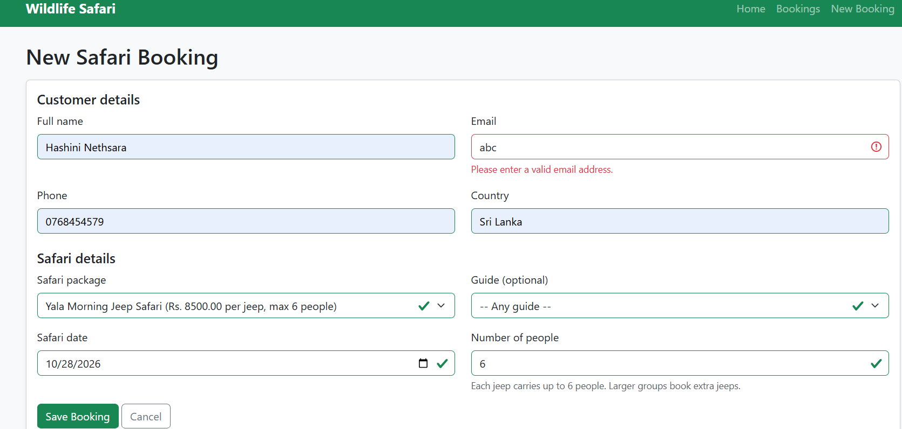
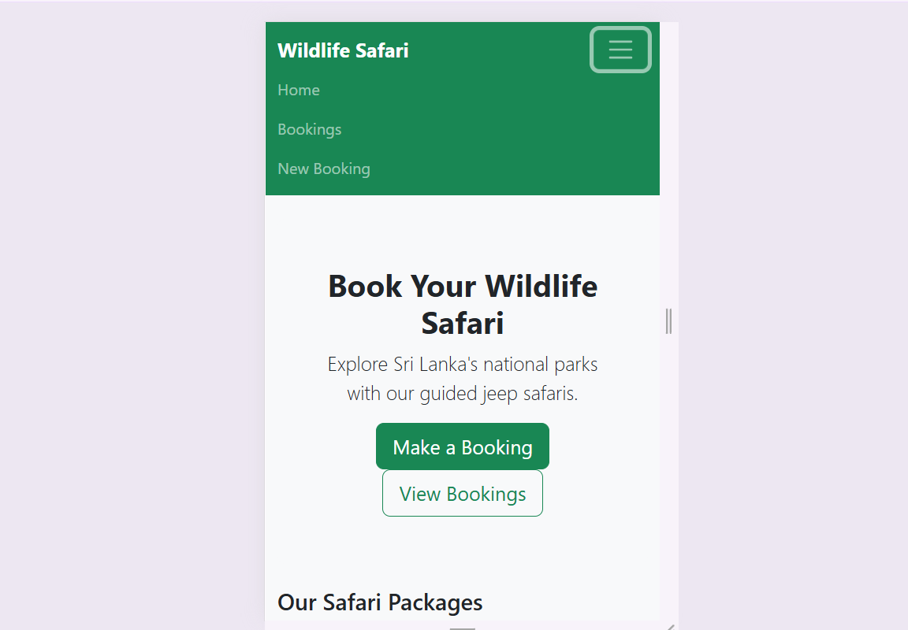

# Online Wildlife Safari Reservation and Management System

EE4307 Web Application Development Mini Project
**Student:** [Singaneththi h n] | **Index number:** [EG/2023/5899]

## Description

A web application for booking wildlife jeep safaris in Sri Lankan national parks. Staff can create, view, edit and delete bookings. Customers are stored in a MySQL database. The price is calculated **per jeep** (one jeep carries up to 6 people), so larger groups book extra jeeps automatically.

## Features

- **Create** a booking with customer, package, guide, date and number of people
- **Read**: booking list with search by customer name, filter by status, sort by date or price, and a details page
- **Update**: edit a booking and change its status (Pending, Confirmed, Cancelled)
- **Delete** with an "Are you sure?" confirmation popup
- Client-side validation (browser) and server-side validation (Node.js) with clear error messages
- Automatic price calculation: price per jeep x number of jeeps
- Responsive design for mobile, tablet and desktop
- Custom 404 page

## Technologies Used

- Node.js and Express
- EJS templates
- MySQL (XAMPP) with the `mysql2` package
- Bootstrap 5
- Git and GitHub

## Setup Steps

1. Install [Node.js](https://nodejs.org) (LTS) and [XAMPP](https://www.apachefriends.org).
2. Start **Apache** and **MySQL** in the XAMPP Control Panel.
3. Clone the repository:
   ```
   git clone https://github.com/hashininethsara18-wq/Online-Wildlife-Safari-Reservation-and-Management-System.git
   cd Online-Wildlife-Safari-Reservation-and-Management-System
   ```
4. Install packages:
   ```
   npm install
   ```
5. Create the database: open `http://localhost/phpmyadmin`, click **Import**, choose `database.sql`, and click **Go**.
6. Copy `.env.example` to a new file named `.env`. The default values work with XAMPP (user `root`, empty password).
7. Start the app:
   ```
   node app.js
   ```
8. Open `http://localhost:3000` in your browser.

## Database Design

The database `safari_db` has 5 tables: `parks`, `safari_packages`, `guides`, `customers` and `bookings`.

- One park has many safari packages.
- One customer, one package and one guide can each have many bookings.



## Screenshots

### Home page


### Create booking


### Booking list with search, filter and sort


### Booking details


### Edit booking


### Delete confirmation


### Validation messages


### Mobile view


## Project Structure

```
safari-project/
├── app.js              main server file
├── config/db.js        database connection
├── routes/bookings.js  booking routes (CRUD)
├── views/              EJS pages and partials
├── public/             CSS and JavaScript
├── docs/               ERD and screenshots
├── database.sql        database schema and sample data
└── .env.example        example settings
```

## Notes

- Database credentials are in `.env`, which is not uploaded to GitHub. Use `.env.example` as a guide.
- Default XAMPP MySQL login: user `root`, no password.